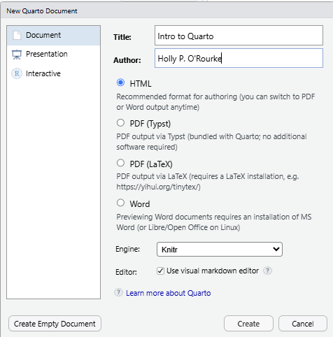
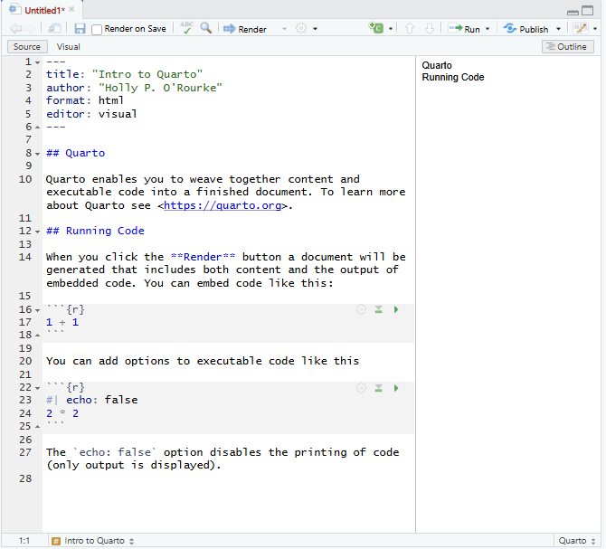
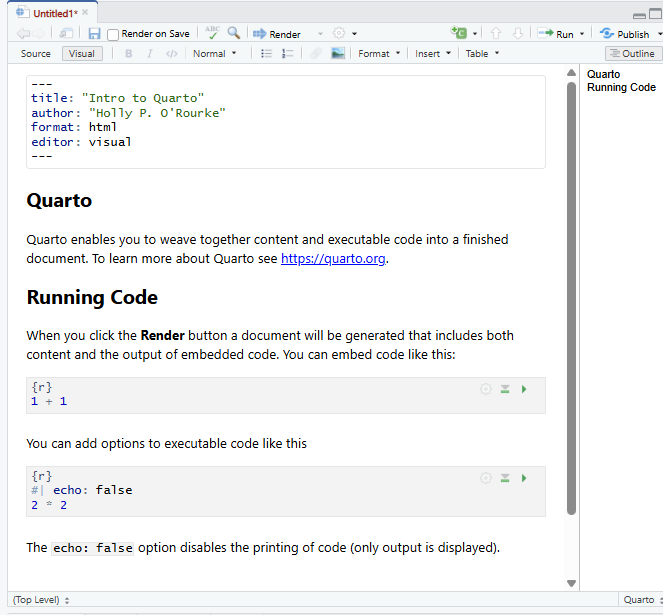
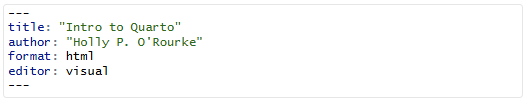
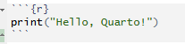

```{r xaringanExtra, echo=FALSE}
xaringanExtra::use_xaringan_extra(c("tile_view","broadcast"))
```

```{r xaringan-themer, include=FALSE, warning=FALSE}
# Set up custom theme
library(xaringanthemer)
style_mono_accent(
  base_color = "#1c5253",
  header_font_google = google_font("Josefin Sans"),
  text_font_google   = google_font("Montserrat", "300", "300i", "700"),
  code_font_google   = google_font("Fira Mono"),
  base_font_size = "20px",
  text_font_size = "1.5rem",
  header_h1_font_size = "3rem",
  header_h2_font_size = "2.5rem",
  header_h3_font_size = "2rem",
text_slide_number_color = "#1c5253",
  text_slide_number_font_size = "0.9em",
  padding = "6px 36px 6px 36px",
  extra_css = list(
    ".remark-slide-content h1" = list("margin-bottom" = "0.3em"),
    ".pull-left"  = list(width = "49%"),
    ".pull-right" = list(width = "49%"),
    ".col-text" = list(float = "left",  width = "30%"),
    ".col-img"  = list(float = "right", width = "68%"),
    ".col-img ~ *" = list(clear = "both"),   # keeps later content below the columns
    ".platform-tbl" = list(width = "95%", `table-layout` = "fixed", `font-size` = "0.6em", margin = "auto"),
    ".platform-tbl th, .platform-tbl td" = list(
      `white-space` = "normal", `word-wrap` = "break-word",
      `vertical-align` = "top", `text-align` = "left", padding = "6px 10px"),
    ".platform-tbl th:first-child, .platform-tbl td:first-child" = list(width = "16%"),
    ".platform-tbl td:first-child" = list(`font-weight` = "700"),
    ".small-slide" = list(`font-size` = "1.2em")
  )
)
```

```{r, include = F}
knitr::opts_chunk$set(fig.width = 6, message = FALSE, warning = FALSE, comment = "", cache = F)
library(flipbookr)
library(icons) #https://fontawesome.com/v5.15/icons?d=gallery&p=2&m=free
library(tidyverse)
```

class: inverse, center, middle
# Sharing & Reproducibility
---
# Where to Share

- **OSF update**: OSF is about to become read-only and is no longer allowing creation of new projects (as of today)

- Options for open science worklow repos/workspaces: **Open Science Framework (OSF), GitHub, Zenodo**

- All are free platforms that can be used at various stages of the research process
---
class: middle

```{r platform-table, echo=FALSE}
blue <- function(x) paste0("<span style='color:blue;'><b>!</b></span> ", x)
red  <- function(x) paste0("<span style='color:red;'><b>X</b></span> ", x)

tab <- data.frame(
  ` ` = c("Primary purpose", "Data/files sharing", "Version control",
          "Reproducibility", "DOI linking", "Open science accessibility",
          "Main disadvantage"),
  OSF = c(
    "project management, sharing, preregistration",
    "✓",
    blue("limited to time stamps"),
    "✓ focus on preregistration and documentation",
    "✓",
    "✓ searchable database!",
    red("no code editing version control; no new projects")),
  GitHub = c(
    "hosting, managing, and sharing code/files",
    "✓ (though primarily used for coding)",
    "✓",
    "✓ focus on computational reproducibility",
    red("must be linked to other platform for DOI generation"),
    red("not a searchable research database"),
    red("not a searchable database, and generally not designed for research")),
  Zenodo = c(
    "long-term archiving and publication of research outputs",
    "✓",
    "✓",
    "✓ focus on preservation of files",
    "✓ assigns DOI to each public record",
    "✓ searchable database for completed projects",
    red("limited pre-completion project management")),
  check.names = FALSE
)

# bold the first column and headers
tab[[1]] <- paste0("<b>", tab[[1]], "</b>")
names(tab)[-1] <- paste0("<b>", names(tab)[-1], "</b>")
names(tab)[1] <- ""

knitr::kable(tab, format = "html", escape = FALSE, table.attr = "class='platform-tbl'")
```
---
# Project-Level Reproducibility Tips
- Sharing is key for reproducibility

  * Use platform to share study protocol, materials, data (when possible), and scripts

  * Ideally you can share enough that your worklow is fully reproducible by an external researcher

  * De-identified data can usually be shared, but make all efforts to anonymize
---
# Workflow-Level Reproducibility Tips
- Use **dynamic documents** every step of the way to facilitate sharing, collaborative work, and reproducibility
  
  * GitHub READMEs

  * R Markdown/Quarto reports, .Rproj files

  * Google Docs

- Ideally you can share enough that your worklow is fully reproducible by an external researcher

- De-identified data can usually be shared, but make all efforts to anonymize
---
# Code-Level Reproducibility Tips
- READMEs!!!
  * README should describe what is in each file & the steps to reproduce the analysis
  * Well-commented code with good variable names should make it possible for a 3rd party to work out what the script does

- Use open source software (e.g., R, Python)

- Avoid absolute file paths

- Document hardware and software versions
---
# Document-Level Reproducibility Tips
- Instead of R script comments, use R Markdown to mix commentary, code, tables, and figures
  * Especially useful for EDA, descriptive analyses, and troubleshooting

- From within RStudio, you can render the Markdown in different output formats: html, word, pdf, slides, and more

- `papaja` package can render your Markdown as an APA manuscript (more on that later...)
---
# R Markdown Refresher
- R Markdown combines your usual R script code with written text to create dynamic, reproducible reports 

  * Write text in plain formatting

  * Add chunks of R code that run when you render (i.e., "knit") the file

- Knitting produces a finished report (HTML, PDF, Word, etc.) with the tables and figures already inside
  * `knitr` is the underlying R package that executes the embedded code and weaves the results into the final document

- When you edit the document and change the data/analyses/text, knit again, and everything updates (thus, a "dynamic" document)
---
# Quarto vs. R Markdown
.pull-left[
### R Markdown (.Rmd)
- Created first, built specifically for R
- Uses Pandoc Markdown language to integrate text with code
- Different packages for slides, websites, books, etc.
]

.pull-right[
### Quarto (.qmd)
- The next-generation version of the same idea, using same language
- Works with R, Python, and Julia
- One tool for reports, slides, websites, books, etc.
]

**Same idea in both:** Text and code in one dynamic document
---
class: inverse, center, middle
# Quarto Basics and Document Creation
---
# Quarto Basics
.pull-left[
- To create a new .qmd document, file --> new file --> new Quarto document
- Select the type of document you want
  * Usually a good idea to start with HTML, you can switch types/create multiple types easily
- click "create"
]

.pull-right[
```{r, echo=FALSE, out.width="80%",fig.align="center"}

```
]
---
class: small-slide
# Source vs. Visual Editing
- There will be some code automatically generated for you to easily edit
- There are two ways to edit code: The **source** and **visual** panes
  * You can edit both ways regardless of the option in the "editor" code line

.pull-left[
```{r, echo=FALSE, out.width="80%", fig.align="center"}

```
]
.pull-right[
```{r, echo=FALSE, out.width="80%", fig.align="center"}

```
]
---
# YAML headers
- The code at the very top is header code (YAML) where we provide key metadata and options for the document

- At minimum we have title, author, and format; there are many options to include for output types, formatting, themes, citation styles, etc.

- Here are links to [**HTML options**](https://quarto.org/docs/reference/formats/html.html), [**PDF options**](https://quarto.org/docs/reference/formats/pdf.html), and [**MS Word options**](https://quarto.org/docs/reference/formats/docx.html)

```{r, echo=FALSE, out.width="80%", fig.align="center"}

```
---
# Code Chunks
- To include R code in your Quarto document, you will write it within a code chunk

- You can create a chunk with:

  * **Command + Option + I** for Mac users

  * **Ctrl + Alt + I** for Window users

  * Selecting the "Insert Chunk" option in the "Code" toolbar dropdown 

```{r, echo=FALSE, out.width="50%", fig.align="center"}

```
---
# Markdown Text
- R uses [**Pandoc's Markdown**](https://pandoc.org/MANUAL.html#pandocs-markdown) to format the text with headers, tables, links, citations, etc.
  * We can also include hyperlinks, embedded images, inline code chunks, and more
- Some common formatting options:
  * `*italics*, **bold**, ***bold italics*** `
  * `superscript^2^ / subscript~2~`
  * `~~strikethrough~~`
  * line breaks: `\`
  * `# Heading 1`, `## Heading 2`, `### Heading 3`
  * Links have text in brackets, hyperlink in parentheses
  * `[Quarto](https://quarto.org)`

Links for more markdown basics: [**Quarto**](https://quarto.org/docs/authoring/markdown-basics.html), [**RStudio**](https://rstudio.github.io/cheatsheets/html/rmarkdown.html#write-with-markdown), [**Markdown cheatsheet**](https://rstudio.github.io/cheatsheets/rmarkdown.pdf)
---
# Rendering 
- You must save your document before rendering

- There are several options to render:
  * Click the "render" button
  * Select "Render on save" and render with each save
  * Render from the R console with the Quarto package and use `quarto::quarto_render("yourdoc.qmd")`

- RStudio will usually prompt you to install required packages when you first try to render a document (e..g, knitr, rmarkdown) 

- Rendering will create a preview in RStudio's Viewer and also knits an HTML document with code, output, and results from the .qmd file
---
# In-Class: Course Project Quarto Setup
1. Set up a Quarto document with the following info in YAML
  * title: `PSYC259 Data Science Final Project Report`
  * author: `[Last name, First name]`
  * format: `HTML`
2. Add a block of text with a header "Project Description" and a sample sentence underneath it.
3. Below that, add a placeholder code chunk 
  * For now, just use `print("Hello!")` within the code chunk
4. Before rendering, save file as:
  * `[Lastname]_[Firstname]_PSYC259_datasci_report`
5. Render the document
---
class: inverse, center, middle
# Quarto Code and Output:<br>Info, Guides, Tutorials
---
# Quarto Extension for APA Format: apaquarto
- [**apaquarto**](https://wjschne.github.io/apaquarto/) can be easily installed in RStudio
- To create a new APA document:
  * `quarto::quarto_use_template("wjschne/apaquarto", no_prompt = TRUE)`
- To add formatting to an existing document:
  * `quarto::quarto_add_extension("wjschne/apaquarto", no_prompt = TRUE)`

---
class: small-slide
# Packages for Creating Nicer/APA-Style Tables

These are general to R (not Quarto-specific)
.pull-left[
[**gtsummary**](https://www.danieldsjoberg.com/gtsummary/) package creates publication-ready summary tables
- `tbl_summary(data)` makes descriptives tables (means, SDs, counts)
- `tbl_regression(model)` formats regression results
- Works in R Markdown **and** Quarto, and exports to HTML, Word, and PDF
]

.pull-right[
[**papaja**](https://frederikaust.com/papaja_man/): APA-style manuscripts in R Markdown
- `apa_table()` formats tables in APA style
- `apa_print()` coverts model results to APA-formatted text (e.g., *t*(28) = 2.10, *p* = .045)
- `theme_apa()` gives **ggplot2** figures an "APA" look (clean axes, no gridlines)
- Built for R Markdown, so it is not a Quarto extension
]
- `papaja` has more helper functions than `apaquarto` (e.g., `apa_barplot()`, `apa_beeplot()`, etc.), so it is a useful addition to `apaquarto`'s functionality which is primarily document formatting
---
# Quarto Code Options/Tutorials
.center[
  Link: [**Follow along here**](https://quarto.org/docs/get-started/computations/rstudio.html)
]

- Displaying code, code folding, code linking, figures, data frames, inline code, caching
---
# Quarto Output Options/Tutorials
.center[
Link: [**Follow along here**](https://quarto.org/docs/get-started/authoring/rstudio.html)
]

- Output formats, PDFs, multiple format saving, sections/tables of contents, equations, citations, cross-referencing within document, callouts, layout options

<!-- adjust font size and other formatting defs in this css code chunk -->
```{css, eval = TRUE, echo = FALSE}
.remark-code{line-height: 1; font-size: 70%}

@media print {
  .has-continuation {
    display: block;
  }
}

code.r.hljs.remark-code{
  position: relative;
  overflow-x: hidden;
}

.remark-slide-number {
  opacity: 1; /* default: 0.5 */
}

.content-box { 
    box-sizing: border-box;
    background-color: #e2e2e2;
}
.content-box-blue,
.content-box-gray,
.content-box-grey,
.content-box-army,
.content-box-green,
.content-box-purple,
.content-box-red,
.content-box-yellow {
  box-sizing: border-box;
  border-radius: 15px;
  margin: 0 0 15px;
  overflow: hidden;
  padding: 0px 20px 0px 20px;
  width: 100%;
}
.content-box-blue { background-color: #F0F8FF; }
.content-box-gray { background-color: #e2e2e2; }
.content-box-grey {	background-color: #F5F5F5; }
.content-box-army {	background-color: #737a36; }
.content-box-green { background-color: #d9edc2; }
.content-box-purple { background-color: #e2e2f9; }
.content-box-red { background-color: #ffcccc; }
.content-box-yellow { background-color: #fef5c4; }
.content-box-blue .remark-inline-code,
.content-box-blue .remark-inline-code,
.content-box-gray .remark-inline-code,
.content-box-grey .remark-inline-code,
.content-box-army .remark-inline-code,
.content-box-green .remark-inline-code,
.content-box-purple .remark-inline-code,
.content-box-red .remark-inline-code,
.content-box-yellow .remark-inline-code { 
  background: none;
}

.scroll-box-8 {
  height:8em;
  overflow-y: scroll;
}
.scroll-box-10 {
  height:10em;
  overflow-y: scroll;
}
.scroll-box-12 {
  height:12em;
  overflow-y: scroll;
}
.scroll-box-14 {
  height:14em;
  overflow-y: scroll;
}
.scroll-box-16 {
  height:16em;
  overflow-y: scroll;
}
.scroll-box-18 {
  height:18em;
  overflow-y: scroll;
}
.scroll-box-20 {
  height:20em;
  overflow-y: scroll;
}
.scroll-output {
  height: 90%;
  overflow-y: scroll;
}
}

/************************
 * Font size and colours
 ************************/

/*      LaTeX style       */
.Large       , .Large .remark-code, .Large .remark-inline-code { font-size: 144%; }
.large       , .large .remark-code, .large .remark-inline-code { font-size: 120%; }
.small       , .small .remark-code, .small .remark-inline-code { font-size: 90%; }
.footnotesize, .footnotesize .remark-code, .footnotesize .remark-inline-code { font-size: 80%; }
.scriptsize  , .scriptsize .remark-code, .scriptsize .remark-inline-code { font-size: 70%; }
.tiny        , .tiny .remark-code, .tiny .remark-inline-code { font-size: 60%; }

/* or you can be more specific */
.font10 , .code10 .remark-code, .code10 .remark-inline-code{ font-size: 10%; }
.font20 , .code20 .remark-code, .code20 .remark-inline-code{ font-size: 20%; }
.font30 , .code30 .remark-code, .code30 .remark-inline-code{ font-size: 30%; }
.font40 , .code40 .remark-code, .code40 .remark-inline-code{ font-size: 40%; }
.font50 , .code50 .remark-code, .code50 .remark-inline-code{ font-size: 50%; }
.font60 , .code60 .remark-code, .code60 .remark-inline-code{ font-size: 60%; }
.font70 , .code70 .remark-code, .code70 .remark-inline-code{ font-size: 70%; }
.font75 , .code75 .remark-code, .code75 .remark-inline-code{ font-size: 75%; }
.font80 , .code80 .remark-code, .code80 .remark-inline-code{ font-size: 80%; }
.font90 , .code90 .remark-code, .code90 .remark-inline-code{ font-size: 90%; }
.font100, .code100 .remark-code, .code100 .remark-inline-code{ font-size: 100%; }
.font110, .code110 .remark-code, .code110 .remark-inline-code{ font-size: 110%; }
.font120, .code120 .remark-code, .code120 .remark-inline-code{ font-size: 120%; }
.font130, .code130 .remark-code, .code130 .remark-inline-code{ font-size: 130%; }
.font140, .code140 .remark-code, .code140 .remark-inline-code{ font-size: 140%; }
.font150, .code150 .remark-code, .code150 .remark-inline-code{ font-size: 150%; }
.font160, .code160 .remark-code, .code160 .remark-inline-code{ font-size: 160%; }
.font170, .code170 .remark-code, .code170 .remark-inline-code{ font-size: 170%; }
.font175, .code175 .remark-code, .code175 .remark-inline-code{ font-size: 175%; }
.font180, .code180 .remark-code, .code180 .remark-inline-code{ font-size: 180%; }
.font190, .code190 .remark-code, .code190 .remark-inline-code{ font-size: 190%; }
.font200, .code200 .remark-code, .code200 .remark-inline-code{ font-size: 200%; }

.brand-red { color: #e64626; }
.brand-blue { color: #0148A4; }
.brand-yellow { color: #FFB800; }
.brand-charcoal {color: #424242; }
.brand-gray {color: #F1F1F1;}
.brand-grey {color: #F1F1F1;}
.black { color: black; }
.white { color: white; }
.red { color: red; }
.blue { color: blue; }
.green { color: green; }
.yellow { color: yellow; }
.orange { color: orange; }
.purple { color: purple; }
.gray { color: gray; }
.grey { color: gray; }

.bold { font-weight: bold; }
.bolder { font-weight: bolder; }
```

